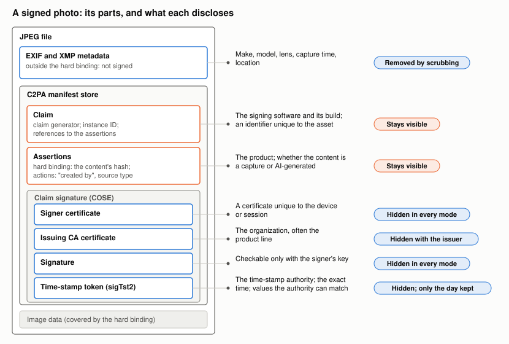
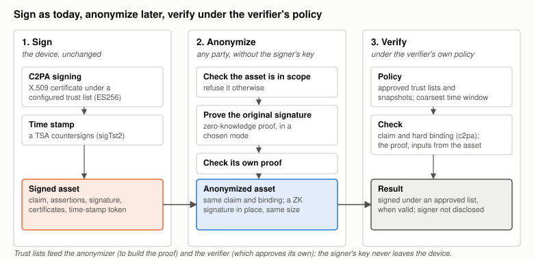
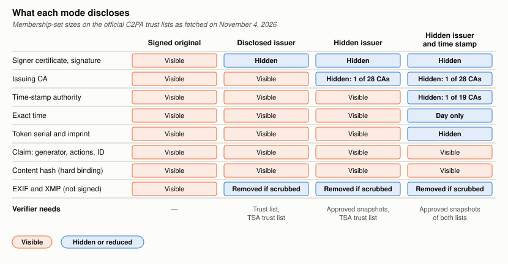
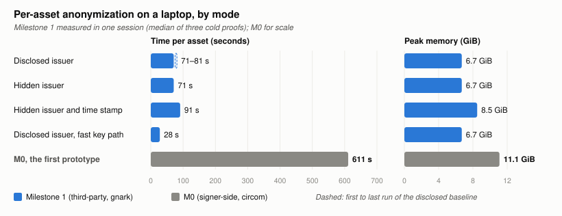

# Signer Privacy for C2PA: Anonymizing Signed Content with Zero-Knowledge Proofs

*Draft, November 17, 2026*

## Executive summary

A C2PA manifest makes content verifiable by binding it to a signature, and that signature identifies its signer. Through the signer's certificate, its issuing CA, its time-stamp token, and the claim itself, a signed photo can reveal the organization and product that produced it, the moment it was captured, and a certificate unique to the device or session. For many uses of provenance, such as conflict-zone journalism, human-rights documentation, or an individual sharing a photo, this is more than the verifier needs, and more than the creator may safely disclose.

This paper describes a prototype, first outlined in [15], that hides the credentials behind a C2PA signature while keeping the content verifiable. Content is signed exactly as today, with X.509 certificates under a configured trust list (such as the official C2PA one). Afterwards, any party, without the signer's key, can replace the signature with a zero-knowledge proof of that signature and of selected checks on its certificate. In its most private mode, the proof shows that the claim was signed by a certificate that one of a trust list's eligible CAs issued for claim signing, and that a TSA certified under a TSA trust list time-stamped it within a given day while the certificate was valid. The claim, its assertions, and its hard binding are kept unchanged and public, so a verifier still checks the content's integrity. The verifier, not the anonymizer, decides which trust lists it accepts.

Two qualifications frame the results. The prototype verifies a reduced set of certificate and time-stamp checks, not everything a full C2PA and X.509 validator checks. And it hides credentials, reducing what an asset discloses, without by itself guaranteeing that the source, device, organization, or capture time cannot be inferred: the public claim, in particular, can still name them.

The prototype works on real content. Photos from a production smartphone deployment, signed under the official C2PA trust list, were anonymized and verified against the official lists, as fetched on November 4, 2026, in three modes:

| Mode | Hides | Membership set on the official lists (November 4, 2026) |
|---|---|---|
| Disclosed issuer | The signer's certificate, key, and signature | The issuing CA's certificate holders |
| Hidden issuer | Also the issuing CA | 28 CAs from 18 organizations |
| Hidden issuer and time stamp | Also the time-stamp authority and the exact time (only the day is disclosed) | Issuer as above; the TSA among 19 CAs from 14 organizations |

On a test asset mirroring the deployment's certificates and time stamps, anonymizing takes 71–91 seconds per asset on a laptop, depending on the mode, and 28 seconds for the disclosed mode with an optimized key-loading path; the real photos took 75–141 seconds in single runs. Verifying a proof takes about 30 ms. The proof is 196 bytes with the default curve, and the anonymized file keeps its original size.

With the certificates and the time stamp hidden, the main remaining disclosure is the claim itself: its claim generator and actions can name the software and product. A design for keeping the claim private exists, with a measured prototype, but it departs from C2PA's model of a public claim. That, and five other points that need discussion within C2PA, are listed at the end of this paper.

## 1. The problem: what a C2PA signature reveals

### Why signer privacy matters

C2PA lets a consumer check where content comes from and whether it was altered. The trust it provides comes from the signature backed by a signer certificate issued by a CA on a trust list. These cryptographic elements however make the signer identifiable, which is often not what the creator wants. A journalist documenting a protest, a human-rights organization collecting evidence, or an individual sharing a photo may need the content to be verifiable as signed under an accepted trust list, and unaltered since, without disclosing the device, organization, or the exact moment that produced it.

The goal is therefore not to weaken provenance, but to separate two questions a verifier asks: *was this content signed under a trust list I accept, and is it unaltered?* and *who exactly signed it?* Many verifiers need only the first answer.

### What a signed asset discloses

A C2PA manifest discloses more than its signer certificate. In a photo from a production smartphone deployment, signed under the official trust list, the manifest and the file around it contain:

| Part | What it discloses |
|---|---|
| **Signer certificate** | A short-lived certificate (about 90 days), specific to a device, a session, or a capture (each photo in the samples examined had a distinct serial, which does not tell which); it links content signed under it |
| **Issuing CA certificate** | The organization, and often the product line, whose CA issued the signer certificate |
| **Signature** | Given the signed claim, an ECDSA signature lets anyone recover the signer's public key, and so match it to the certificate: removing the certificate means removing the signature too |
| **Time-stamp token** (`sigTst2`) | The time-stamp authority, which may be the vendor's own; the exact time to the second; and a value the TSA can match to its records |
| **Claim** | The claim generator (the signing software and its build), the actions assertion (for example "created by" a named product, and whether the content is a capture or AI-generated), and identifiers unique to the asset (the instance identifier, and the manifest's label) |
| **Metadata outside the hard binding** | EXIF and XMP: make, model, lens, capture time, and possibly GPS coordinates. This metadata is not authenticated by the claim, yet ships with the file |

<figure>

<figcaption>Figure 1: a signed photo's parts, what each discloses, and what anonymization does with it.</figcaption>
</figure>

Each of these is a separate disclosure: removing the signer certificate alone still leaves the organization in the issuing CA, the TSA, the claim, and the metadata.

### Requirements

A privacy-preserving alternative should:

1. **Keep the content verifiable:** the claim and its assertions, the hard binding to the content, issuance by a trusted CA for claim signing, and the certificate's validity at the time a trusted time-stamp authority attested.
2. **Work with what is deployed:** today's X.509 PKI and trust lists, today's signing devices, and content that has already been signed.
3. **Leave trust decisions to the verifier:** which trust lists, and which versions of them, are acceptable, rather than trusting whoever produced the anonymized asset.
4. **Disclose by choice:** let the creator choose what to hide, with a clear statement of what remains visible.

**Not a goal.** A C2PA signature, and the proof that replaces it, attests that a certified key signed the claim, and that a time-stamp authority saw the signature at a given time. Neither establishes that the content is a physical capture, that its assertions are true, or when it was captured.

## 2. Approaches

Two broad approaches can provide signer privacy.

**New credential schemes.** Privacy-preserving credentials, such as those using BBS signatures [9], let a holder prove selected attributes of a credential (for example "issued by this organization under this policy") without revealing the others, and without making presentations linkable. A BBS version is also available in this project: it embeds a BBS presentation, bound to the asset's hash, in a C2PA manifest. The approach is efficient, with fast proofs of a few hundred bytes, but it requires issuers to adopt a new signature scheme and new issuance infrastructure, and it does not apply to content already signed with X.509 certificates.

**Zero-knowledge proofs over existing signatures.** Content is signed as today. A zero-knowledge proof then shows that a valid signature exists, under a certificate a trusted CA issued, without revealing the signature or the certificate. This keeps the deployed PKI, devices, and trust lists unchanged, and applies to existing content. Its cost is in proving: the proof must verify X.509 certificates and ECDSA signatures, which are expensive to express in a zero-knowledge circuit. This paper focuses on this approach.

**Related work.** Zero-knowledge proofs over existing credentials are an active area: Crescent [10] and Longfellow ZK [11] prove statements about existing JSON Web Tokens and mobile driving licences signed with ECDSA, and zkLogin [12] about OpenID Connect tokens. This work applies the idea to C2PA: the credential is a claim signature and its time stamp, the proof can be made by a third party after the fact, and it replaces the signature in place, inside an otherwise unchanged asset.

### The design space

Within the zero-knowledge approach, the prototype explored four main choices:

- **Who anonymizes.** The signer can anonymize its own content, proving possession of its key. Alternatively, any third party can anonymize content after the fact, from the signed asset alone, by proving the original signature valid. The third-party form needs no change on signing devices and applies to existing content; this is the approach currently implemented in the prototype.
- **What is proved about issuance.** *Trust model A* verifies the CA's signature on the signer's certificate inside the proof, using the existing PKI as is. *Trust model B* proves membership of the signer's key in a Merkle tree that a registration entity publishes, and *trust model C* uses a credential re-issued with a proof-friendly signature scheme. B and C should make proofs much cheaper (an expectation, not yet measured), but need a party to register signers or re-issue credentials, a role an existing CA could take. The prototype implements A; B and C are on the roadmap.
- **What is hidden.** The signer alone, or also the issuing CA, the time-stamp authority, and the exact time, each at a different cost and needing different verifier policies (Section 4).
- **The proof system and curve.** Groth16 [7] was used throughout, for its small proofs and fast verification, first with circom and then with gnark [8], on the BN254 curve (an estimated 100 bits of security [13]) or BLS12-381 (an estimated 120 bits); these are curve-level estimates, not an assessment of the implementation.

## 3. The prototype

### The flow

The prototype separates signing from anonymizing. Neither the signing device nor the C2PA signing process changes.

<figure>

<figcaption>Figure 2: the flow. Content is signed as today; any party anonymizes it later, without the signer's key; a verifier checks it under its own policy.</figcaption>
</figure>

1. **Sign.** The device signs the claim with its X.509 certificate (ES256), and a time-stamp authority time-stamps the signature (`sigTst2`: an RFC 3161 [4] token over the COSE [3] countersignature structure of the protected header and the signature), as in current deployments.
2. **Anonymize.** Any party holding the signed asset (the signer, a publishing platform, or the creator's own tools) runs the anonymizer. The anonymizer first checks that the asset is within the prototype's scope, and refuses it otherwise (Sections 6 and 7). It then generates a proof of the original signature, checks its own proof, and replaces the original signature with the proof, in place.
3. **Verify.** A verifier checks the anonymized asset's claim and hard binding with a C2PA library, and checks the proof against trust lists it approves.

Because anonymizing needs no key, it applies to content signed in the past, and it can be offered by a service without the signer's involvement. The signer can also anonymize its own content with the same tool.

### What the proof establishes

The proof stands in for the signature check. It does not reproduce everything a C2PA validator checks from a signature: it establishes a reduced set of checks, listed below, to which the verifier adds checks on public data. In the default mode, it shows that:

- **the signer was authorized:** the issuing CA signed a certificate with a P-256 key, for C2PA claim signing (its extended key usage), not itself a CA, valid at the time the time-stamp authority attested;
- **the signature is genuine:** the key in that certificate signed this claim, with the original algorithm and header;
- **the time is attested:** the time-stamp token's imprint covers that signature.

The signer's certificate, its public key, the original signature, and the original header stay private inside the proof. The claim itself is a public input that the verifier reads from the asset, so the proof is tied to this exact claim, and through the claim's hard binding, to this exact content.

Some checks remain outside the proof, where they use public data: the issuing CA's chain to the trust list (a partial path validation, not a complete RFC 5280 [6] implementation), the time-stamp token's validity (in the modes where it stays visible), and the claim's assertions and hard binding, checked with a C2PA library.

| Established | Not established |
|---|---|
| The claim, with its assertions and hard binding, is the one originally signed | That the content is a physical capture, that its assertions are true, or when it was captured |
| The signing key was certified for claim signing, not as a CA, by an approved CA, and was valid at the attested time | The full X.509 profile: key usage, unknown critical extensions, names, policies |
| A trusted time-stamp authority attested the signature at that time (in the hidden-token mode: within the published window) | Revocation of the signer's or the time-stamp authority's certificate |
| Neither the signer's certificate nor the original signature is disclosed | That the source cannot be inferred from what stays visible (Section 7) |
| | Calendar validity of certificate dates: a day of 1–31 is accepted in any month, so a CA-signed impossible date would be read as a normalized one. In the hidden-token mode, also the token's `signingCertificateV2`, the authority certificate's other extensions, and the token's accuracy, ordering, and nonce fields |

Inputs outside the supported encodings are refused, but within them, some semantics go unchecked: an unrecognized critical extension, for example, is not rejected by the proof. The known gaps require malformed content signed by a CA; they do not let an ordinary user forge a signature, but they belong in a faithful description of the system. Appendix B gives the exact profile.

### The anonymized asset

The anonymized asset is the original with one change (two if metadata scrubbing is chosen): the claim signature is replaced by a *ZK signature*. It contains:

- the proof: 196 bytes on BN254, or 292 bytes on BLS12-381, whatever the content (gnark's encoding of a Groth16 proof with one commitment; the size depends on the proof system, its encoding, and the curve);
- what the verifier needs to check it: the curve and a fingerprint of the verifying key;
- depending on the mode, the issuing CA's chain, or a reference to an approved list of CAs; and the time-stamp token, or a time window.

The ZK signature is written in place of the original, padded to the same size, so the manifest store and the file keep their sizes. The claim and its assertions are untouched, so the hard binding still matches the content. The ZK signature has a strict encoding: a verifier rejects any unspecified field, nonzero padding, or trailing data. This removes room for extra data in the encoding, but not every channel for it (Section 7).

The ZK signature uses a private-use COSE algorithm identifier and a private header, marked critical, so no standard C2PA validator accepts it, in any mode. In the disclosed mode, standard tools still read the manifest: they report the signature as unsupported, and the claim's assertions and hard binding as matching. In the hidden modes, the signature carries no certificate chain, and the C2PA library used refuses to read the manifest at all. The prototype's verifier therefore checks the claim's assertions and hard binding on a local copy of the asset carrying a fixed placeholder certificate of the same length, disregarding only the expected signature and credential failures; the placeholder never appears in the distributed asset. Supporting these outputs in standard tools would take more than an algorithm number: validators would need to trust the statements' verifying keys, apply a trust policy, and present the result (Section 9).

### The verifier and its policy

The verifier derives every public input of the proof from the asset itself, and trusts nothing the anonymizer asserts. In particular, trust comes from the verifier's own policy:

- **Verifying keys**, one per approved statement, trusted locally. The key fingerprint in the asset is a consistency check, never a reason to trust a key.
- **Trust lists**, for issuers and for time-stamp authorities, which the verifier selects and pins.
- **Snapshots and their periods**, in the hidden modes: each approved version of a list comes with the period during which it applied. The content's time, or in the hidden-token mode the whole window `[t1, t2)`, must fall within the period of each snapshot used (`from ≤ t1` and, if the period has an end, `t2 ≤ until`), for the issuer list and the TSA list independently. A CA removed from a list stays acceptable for content time-stamped while it was listed, and not after.
- **Limits**, optionally, such as the coarsest time window the verifier accepts.

### Implementation

The prototype is open source, in Rust and Go:

- **Proofs:** Groth16 on the BN254 curve, with gnark, with BLS12-381 as an option. Each mode is a separate statement, from 4.7 to 6.5 million constraints, with its own keys from a one-time setup (a proving key of 1.2–1.5 GB; the verifying key is about 2 KB).
- **C2PA:** the anonymizer and verifier read and rewrite manifests with c2pa-rs [14], the reference library, and validate the claim with it.
- **Measurement:** a benchmark harness runs each phase (preparing, proving, verifying, and so on) in its own process, and records time, memory, and page-cache state.
- **Demonstration:** a web interface signs, anonymizes, and verifies in each mode.

## 4. Privacy modes

The three modes differ in what the proof keeps private, and therefore in what the verifier must provide. Each is a separate statement with its own keys, chosen per asset. Metadata scrubbing is independent, and applies to all three.

| | Disclosed issuer | Hidden issuer | Hidden issuer and time stamp |
|---|---|---|---|
| **Proves** | The claim was signed by a certificate the disclosed CA issued for claim signing, valid at the time-stamped time | The same, with the CA one of a verifier-approved list of CAs | The same, with the time stamp verified inside the proof: its TSA certified by a CA in a verifier-approved list, its time within a public window |
| **Discloses** | The issuing CA chain, the time-stamp token, the claim | The time-stamp token, the claim | The time window (by default, the UTC day), the claim |
| **Verifier needs** | A trust list and a TSA trust list | Approved snapshots of the trust list, and a TSA trust list | Approved snapshots of both lists; optionally, a maximum window |
| **Cost** (constraints; time per asset on the test fixture) | 4.7 M; 71–81 s | +0.2%; no measurable difference | +37%; +28% over the hidden issuer |

<figure>

<figcaption>Figure 3: what each mode discloses, and what the verifier needs. Membership-set sizes on the official lists as fetched on November 4, 2026.</figcaption>
</figure>

### Disclosed issuer

The default mode hides the signer: its certificate, with its serial number and exact validity period (a fingerprint when certificates are issued shortly before capture), its public key, the original signature, and any stapled revocation response. The issuing CA's chain stays in the asset, and the verifier validates it against its trust list. The membership set is everyone that CA certified.

Two anonymized assets from the same signer cannot be linked through their proofs, which carry no per-signer value. They can still be correlated through what remains visible, such as the CA, the software version, or the time.

### Hidden issuer

On the official trust list, CAs are run per organization, and often per product line, so the issuing CA alone can identify the organization. In this mode, the proof shows that the issuing CA is a member of a Merkle tree built over the trust list's selected CAs, and the CA itself stays private. The membership set is the tree's CAs; on the official list, it changes as CAs are added and removed (Section 6 gives its size at the time of the experiments). Its size bounds the anonymity the proof provides; it does not measure it, since other disclosures narrow it, and it counts CAs, not signers.

- **The verifier builds the tree itself,** from a trust-list snapshot it approves, and accepts only the roots it built. The asset carries a hint naming its list, never trusted.
- **Each leaf commits to a CA's key and its validity period,** and the proof checks that validity at the attested time.
- **Only eligible CAs enter the tree.** The verifier checks eligibility when building the tree: a CA allowed to issue for the purpose (claim signing here, time stamping for the TSA tree), and without name or policy constraints, which the hidden statement cannot enforce.
- **Subsets** are possible: a verifier may approve a tree over a few organizations' CAs, at the cost of a smaller set, which the root reveals. Assets then need proofs against that root, but no new setup.
- **The tree has a fixed depth** (up to 256 CAs), so the proof hides the CA's position, and one circuit serves any list size. The root itself identifies the approved list to anyone who rebuilds it.
- **The CA must be listed directly,** as the deployment's issuing CAs are; a CA reached through an unlisted intermediate is not covered.

This mode costs almost nothing over the disclosed one. But it hides less than its membership set suggests when the time-stamp token, which stays visible, names the organization. In the production deployment examined, the same organization runs the CA, the time-stamp authority, and the claim generator: the hidden-issuer output verifies, but its token still names the organization. Hiding the issuer alone helps where the CA is the narrowest disclosure, for example a newsroom with its own CA using common signing software and a shared time-stamp authority.

### Hidden issuer and time stamp

The time-stamp token discloses three things: the authority that issued it, the exact time to the second, and values (a serial number and an imprint) that the authority can match to its records of the original request. In this mode, the proof verifies the token itself, under a reduced profile matching the deployment's tokens (Appendix B), and the anonymized asset carries no token:

- **The authority** is shown to be certified by a CA in a second verifier-approved tree, built from the TSA trust list (Section 6 gives its size). The two trees are hashed in separate domains, so a root or path built for one role fails as the other; this guards against mix-ups, not against approving the wrong list.
- **The time** is disclosed only as a half-open window `[t1, t2)` aligned to fixed boundaries, by default the UTC day. The certificates' validity is still checked inside the proof at the exact, private time. The window is a setting, from one second to 366 days, and the verifier may set the coarsest it accepts. The window contains the authority's reported time; it is not a proved capture time, and the token's accuracy field is not checked.
- **The authority's records:** hiding the token removes its direct request identifiers, the serial number and the imprint. The window remains a correlation channel: the operator can narrow the asset to the requests it served in that window, and auxiliary information (the original asset, metadata times, the claim) can narrow it further, possibly to a single request.

This mode costs 37% more constraints and, on the test fixture, 28% more time than the hidden issuer, and 8.5 GiB of memory instead of 6.7.

### Metadata scrubbing

C2PA's hard binding excludes some byte ranges from the content hash, typically the manifest store, and on the deployment examined, also the EXIF and XMP segments, with make, model, capture time, and location. This metadata is not authenticated by the claim, yet ships with the file. With scrubbing enabled, the anonymizer overwrites those segments in place (for JPEG), so the hard binding still matches. Metadata inside the hard binding is signed, and cannot be removed without invalidating the claim; the anonymizer reports it instead.

With every option enabled, the remaining mention of the organization in the deployment's photos is in the claim; and the content's hash still links the output to any copy of the original (Section 7).

## 5. What we tested and learned

The prototype was built as a feasibility study with two goals: show that the approach works and compare its options by cost and by what they disclose; and establish what works on content signed by real deployments today. Each option was implemented and measured, rather than settled on paper.

### From the first prototype to Milestone 1

The first prototype (Milestone 0, M0) was a signer-side proof in circom: the signer proved possession of its key and a digest of the asset, under a test PKI with P-256 keys. It worked, but was far from deployable: it took over ten minutes per asset, used a time the signer chose, and matched none of the CAs on the official trust list, which use P-384, RSA, or P-521 keys. Milestone 1 replaced it step by step. The comparison below is historical and end to end: the statement, the accepted inputs, what is disclosed, and the software all changed together, so it does not measure any one optimization.

| | M0 (starting point) | Milestone 1 |
|---|---|---|
| **Who anonymizes** | The signer, with its key | Anyone, without the key |
| **What the proof covers** | A digest of the asset, and possession of the key | The original signature over the original claim, so the claim and its hard binding stay valid |
| **Certificates** | A P-256 test PKI | P-384 CAs and P-256 signers, as on the official trust list |
| **Time** | Chosen by the signer | A trusted time stamp, bound to the signature or verified in the proof |
| **What is hidden** | The signer | The signer, its CA, its time-stamp authority, the exact time, and unbound metadata |
| **Real content** | None | Real device photos, verified against the official lists |
| **Proof system** | Groth16 with circom | Groth16 with gnark |
| **Per-asset anonymization** | 611 s, 11.1 GiB | 71–91 s, 6.7–8.5 GiB, depending on the mode, on the test fixture; 28 s with the fast key path (disclosed mode) |

### The experiments

**The cost of real-world algorithms.** No CA on the official trust list uses the P-256 keys of the first prototype: 28 of its 33 certificates use P-384, with SHA-384. Measured as standalone circuits, verifying a CA's signature with P-384 and SHA-384 costs 1.3–1.5 times as much as with P-256 and SHA-256, and hashing, not the signature, dominates at real certificate sizes. The same measurements showed gnark's ECDSA circuit to be 13 times smaller than the circom library M0 used, and its witness generation, native rather than in WebAssembly, to take seconds rather than minutes. Milestone 1 therefore moved to gnark. RSA, used by four CAs on the list and by many signers of older content, was also measured as standalone circuits. Verifying an RSA CA's PKCS#1 signature costs less than verifying a P-384 one; but a PS256 signer costs 3.5–6 times an ES256 one, because of its hashing. Neither is yet part of the statement. P-521, used by one CA on each list, and Ed25519 were not measured.

**Who anonymizes.** A third-party statement was designed and adopted: it proves the original signature, so it needs no key, applies to existing content, and keeps the original claim. A signer wanting to anonymize its own content signs normally and runs the same prover.

**Loading the proving key.** Once the statement was in gnark, about three quarters of the per-asset time was spent loading the 1.15 GB proving key, mostly validating every curve point as it is read, while the proof itself takes 16–20 seconds. Loading an uncompressed key without point validation, behind a hash recorded when the key was generated, cuts the disclosed mode's time per asset on the test fixture from 71–81 seconds to 28 seconds. This is safe only for a key of trusted provenance: the recorded hash detects corruption and mix-ups, not someone able to replace both the key and its hash; and neither the hash nor point validation shows that a key came from a trustworthy setup. The fast path is therefore opt-in, with its provenance recorded and checked.

**The curve.** BN254, the default, offers an estimated 100 bits of security; BLS12-381 about 120 (curve-level estimates). The disclosed statement on BLS12-381, measured in a separate session, takes 302 seconds per asset with the default key loading, and 88 seconds with the fast path, with a 292-byte proof. Both curves are supported; the choice is a trade-off between security margin and speed.

**Edited content.** An edited asset carries its ingredients' manifests, each naming its own signer, and later claims commit to their ingredients' signatures, so an ingredient's signature cannot be replaced afterwards without breaking the provenance chain. The anonymizer therefore refuses multi-manifest assets. The supported order is to anonymize first, then edit: an anonymized asset, resized and signed by a second signer, keeps its anonymized manifest as an ingredient, and its proof still verifies. Two limits apply. The C2PA library rates the whole edited asset Invalid, because the ingredient's unsupported signature propagates, even though the editor's own manifest validates and its ingredient reference resolves. And the proof establishes the ingredient's original signature, not the editor's link to it or its account of the edit. Checking an ingredient's proof is a library function, demonstrated in the disclosed mode.

**Hiding more.** Hiding the issuing CA costs almost nothing; hiding the time-stamp token costs 28% more time (Section 4). Keeping the claim private was designed, and its core measured on its own: an estimated 8% more constraints (Section 8).

**Trust models B and C** (a registration entity's Merkle tree of signer keys, or proof-friendly credentials) were analyzed but not built. They would remove the most expensive part of the proof, the CA's signature over the certificate, but need a party to publish a tree of signer keys or issue credentials (Section 8).

### Performance

All modes were measured in one session on a laptop (Intel Core i7-13800H, 20 logical CPUs, 32 GB of memory), on a test fixture whose certificates and time stamp mirror the production deployment's:

| Mode | Per-asset anonymization | Peak memory | Verification: proof alone (full verifier) |
|---|---|---|---|
| Disclosed issuer | 71–81 s | 6.7 GiB | 32 ms (55–61 ms) |
| Hidden issuer | 71 s | 6.7 GiB | 32 ms (83 ms) |
| Hidden issuer and time stamp | 91 s | 8.5 GiB | 31 ms (108 ms) |
| Disclosed issuer, fast key path | 28 s | 6.7 GiB | 37 ms (48 ms) |
| *For comparison: M0, the first prototype (signer-side, circom)* | *611 s* | *11.1 GiB* | *13 ms (19 ms)* |

<figure>

<figcaption>Figure 4: per-asset anonymization time and peak memory, by mode, with M0, the first prototype, for scale.</figcaption>
</figure>

- **Where the time goes:** loading the proving key, about 50–70 seconds of each run with the default loading; the proof itself, 16–20 seconds. Preparing the inputs and rewriting the asset take milliseconds.
- **Real photos** from the production deployment took 75–141 seconds in single runs on the same laptop: 133 s in the disclosed mode (first photo); 75 s with the issuer hidden, with the cache state not controlled; and 141 s with the issuer and time stamp hidden, or 129 s with scrubbing (second photo).
- **Verification** is fast in every mode: about 30 ms for the proof, and up to about 0.1 s for the full verifier, which also checks the claim with c2pa and, in the hidden modes, builds the trees from the approved lists.
- **Against the targets set at the start:** a third-party anonymizer (within 5 minutes and 16 GB per asset) is met in every mode, on the fixture and the real photos. Anonymizing on a phone (within 30 seconds and 2 GB) is not: memory is three to four times over.
- **One-time setup** takes 7–12 minutes per mode and about 11 GB of memory.

**Method.** Each phase runs in its own process; loading the key, solving the witness, and proving are timed within the proving phase. Proving is repeated three times, each run started with the key and constraint system evicted from the operating system's page cache (the observed residency is recorded); the median proof is reported, added to the single runs of the other phases, and peak memory is the maximum over runs. Verification times are single runs. Modes are compared within one session, with the baseline first and last, because this laptop's timings vary by 10–40% between sessions; the baseline still moved by 12% within the session (81 s, then 71 s), so this reduces drift without removing it. Sessions are checked for sleeps, and a session with one is discarded.

## 6. Real-world findings

The prototype targets what is deployed. The official C2PA trust lists and real signed content were examined first, and determined the statement's design.

### The trust lists

| | Claim-signing trust list | TSA trust list |
|---|---|---|
| **Certificates** | 33, from 19 organizations | 24, from 15 organizations |
| **Keys** | 28 P-384, 4 RSA-4096, 1 P-521; no P-256 | 19 P-384, 4 RSA-4096, 1 P-521 |
| **Eligible for the hidden modes** (P-384) | 28 CAs, from 18 organizations | 19 CAs, from 14 organizations |

*The official lists as fetched on November 4, 2026 (`c2pa-org/conformance-public` [2], commit `a95f2c4`), used for every experiment in this paper.*

- **The lists change.** Certificates are added and removed over time, so these counts, and the hidden modes' membership sets, are those of one snapshot. A verifier's policy names the snapshots it approves and when each applied; a tree built from a newer snapshot has a different root and size.

- **Issuing CAs are listed directly.** Organizations list the intermediate CAs that issue signer certificates, often per product line, so a signer's issuing CA is typically itself on the list. This makes the hidden-issuer tree straightforward, and also makes the issuing CA a precise disclosure.
- **The lists are not signed.** They are files in a public repository, so a verifier must pin the version it trusts, for example by its hash. Their history is in the repository's version control, which gives the snapshots and dates that the hidden modes' policy needs, but not in a verifiable form.
- **The two lists share a root.** One organization's root is on both lists, so its time-stamping chain also validates against the claim-signing list. A verifier must use each list for its purpose, and check each certificate's intended use.
- **The earlier interim list** is frozen but still trusted for existing content. It holds many RSA and P-256 keys, and 115 directly trusted signer certificates, which a CA-based statement cannot cover. It is not a target of this prototype.

### Real content

Photos from a production smartphone deployment, signed under the official trust list, were anonymized and verified against the official lists, with unchanged tools: the first photo in the disclosed mode, the second in both hidden modes, with and without scrubbing (Appendix C).

- **The encodings match.** The deployment's signatures (ES256, P-256 keys, signer certificates issued by a listed P-384 CA), its time stamps (`sigTst2`, from a time-stamp authority with the same chain shape), and its claim structures are those the prototype expects. No adjustment was needed.
- **The output keeps its size,** with the signature replaced in place in the JPEG file, and the hard binding still matches.
- **Content can be anonymized after its certificate has expired:** the proof checks validity at the time-stamped time, as C2PA validation does.
- **The hard binding excludes the EXIF and XMP segments,** which carry the make, model, lens, capture time, and location. They are removed by metadata scrubbing.
- **Standard tools fail closed:** on the disclosed-mode output, a standard C2PA tool reports the signature as unsupported, while matching the assertions and hard binding.

### What is refused, and what is kept

- **Edited content with several manifests:** the anonymizer refuses it (Section 5).
- **Raw images (DNG):** their format cannot be rewritten at the same size with the current C2PA library, so the hard binding would break.
- **Other algorithms:** RSA signatures, legacy time stamps (`sigTst`), and content without a time stamp, all common in content trusted through the interim list, are not yet supported.
- **Signed metadata is kept, and reported:** some content, such as an AI-generated sample, signs vendor-identifying XMP and IPTC metadata inside the hard binding. The anonymizer accepts it, but cannot remove it without invalidating the claim.

## 7. What stays visible, assumptions, and limits

### What stays visible

Anonymization removes the signing credentials, but not everything that can identify the source:

- **The claim.** It is kept unchanged, because its signature is what the proof is about, and its hard binding protects the content. Its claim generator names the signing software and its build; its actions assertion can name the product ("created by" a named app or service) and says whether the content is a capture or AI-generated; and its instance identifier, like the manifest's label, is unique to the asset. With the certificates and time stamp hidden, **the claim is the main remaining disclosure**. For content from a vertically integrated deployment, where one organization runs the CA, the time-stamp authority, and the software, the claim still names that organization.
- **The content's hash,** in the hard binding. Anyone holding the original signed asset can link it to the anonymized one: anonymization protects the signer only if the original is not published elsewhere.
- **Signed metadata,** inside the hard binding, which cannot be removed without invalidating the claim.
- **The time window,** by default the day. The time-stamp authority can narrow the asset to the requests it served in that window, and further with auxiliary information. From the proof alone, assets in the same window cannot be ordered.
- **The algorithms and the approved lists:** the signature algorithm (which limits the membership set to CAs of the supported key type), and, in the hidden modes, which list snapshots the proof was made against.

Two anonymized assets from the same signer cannot be linked through their proofs, but can be correlated through any of the above.

### Assumptions

- **The trust lists are authentic,** and the verifier approves the snapshots it accepts, with the periods during which they applied. The real-content experiments approved the current lists retrospectively, which shows acceptance under that policy, not that the CAs were listed when the content was signed.
- **The setup is trusted.** Groth16 keys come from a one-time setup per statement; whoever runs it could produce false proofs. The prototype's keys come from a single-party setup on the developer's machine. A deployment would need a multi-party setup ceremony, or a proof system without a trusted setup.
- **The anonymizer is honest toward the signer.** It sees what it hides, and could leak it. The strict encoding of the ZK signature removes room for extra data in the encoding, but not every covert channel: proofs are randomized, and a visible time-stamp token can carry extra data. Privacy also depends on where the anonymizer runs: a remote service sees exactly the identity and content it removes, and could keep logs or the original.
- **Revocation is not checked,** neither for the signer's certificate nor for the time-stamp authority's.

### Limits of the current prototype

- **Reduced checks.** The proof verifies a reduced predicate (Section 3 lists what it does not establish), and the off-circuit chain validation is partial. Encodings outside the profile are refused, but some semantics within it go unchecked. It is not a replacement for full C2PA and X.509 validation.
- **Algorithms and encodings:** ES256 claim signatures; P-384 CAs, listed directly on the trust lists in the hidden modes; `sigTst2` time stamps; and the header layout and DER encodings of current deployments (Appendix B).
- **Sizes:** a claim of up to 1 KB, a protected header of up to 2 KB, and a signer TBSCertificate of up to 1 KB, which covers the real samples; in the hidden-token mode, also signed attributes and TSTInfo of up to 256 bytes each, and a TSA TBSCertificate of up to 1 KB.
- **What the anonymizer refuses before proving:** other signature algorithms; content without a time stamp; signers not chaining to the trust list at the time-stamped time; claims with identity assertions or ingredients; content with several manifests; content whose proof would not fit in the original signature's space; and formats whose manifest cannot be rewritten at the same size (TIFF-based formats, such as DNG). Metadata scrubbing supports JPEG.
- **Performance:** 1 to 1.5 minutes per asset on the test fixture, up to about 2.5 minutes on the real photos, and 7–9 GB of memory, on a laptop, which suits a service or a desktop tool, not a phone.

## 8. Roadmap

Milestone 1 is the end of the first phase. The second phase depends in part on the C2PA community's view of the questions in Section 9.

### Claim privacy

The claim is now the main disclosure, and C2PA's redaction mechanism cannot hide it: a claim cannot redact its own assertions, and actions assertions can never be redacted (C2PA 2.5 [1], §14.10.2 and §8.8). The proposed design keeps the original claim private instead:

- **The proof** shows that the original, signed claim references the assertions that are disclosed, always including the hard binding. It does so by walking the claim's CBOR structure inside the circuit.
- **The anonymized asset** carries a new claim, written by the anonymizer, listing only the disclosed assertions, with a fresh instance identifier and manifest label.
- **The cost** of the claim walk, measured as a standalone gadget with four reference slots (the hard binding and up to three others): 510,920 constraints, an estimated 8% over the most private mode. It accepts the real deployment's claims.
- **Not yet implemented:** the same-size replacement claim, the new manifest label, and the handling of undisclosed assertions are designed, not built.

This departs from C2PA's model, in which the signed claim is public, which is why it was designed but not built. A refinement would disclose part of an assertion, such as the digital source type (capture or AI-generated) without the product's name, for an estimated further 0.4–0.6 million constraints.

### Trust models

- **Signer membership (B):** a party validates each signer's certificate chain and publishes a Merkle tree of signer keys. Proofs should become much cheaper, since the CA's signature over the certificate is no longer verified in the proof. Revocation comes from removing a key from the next tree, provided verifiers stop accepting older roots for new content. Signers trusted directly, such as those of the interim list, can be covered from their published list.
- **Proof-friendly credentials (C):** a party re-issues each signer's key with a signature scheme that is cheap to verify in a proof.

Both need a party to publish the tree or issue the credentials. It need not be a new one: an existing CA could take the role, as could the C2PA conformance program or an anonymity service. Their costs are expected, not yet measured.

### Toward production

- **Setup:** a multi-party ceremony, or a proof system without a trusted setup, including those designed for proofs over ECDSA credentials.
- **Revocation** of signer and time-stamp certificates.
- **The full certificate profile,** checked in the proof.
- **Time stamping:** guidance or support for time-stamp requests that limit what the authority can link.
- **Tooling:** continuous integration with real proofs, and support in standard C2PA tools.

### Coverage

- **Other CAs, authorities, and signers:** the RSA CAs of the official lists (their primitives were measured) and its P-521 CA (not measured), and PS256 signers.
- **Other formats** for metadata scrubbing, and in-place rewriting for TIFF-based formats.
- **Edited content:** proving a provenance chain whose ingredients were anonymized.
- **Signing devices:** anonymizing on a phone needs a several-fold reduction in memory.

## 9. Questions for the C2PA community

1. **A private claim.** Hiding the claim generator and actions requires an output whose visible claim the original signer did not sign, with a proof that the signed claim referenced the disclosed assertions. Is this a direction C2PA would consider, and what should a validator report?
2. **The ZK signature.** It uses a private-use COSE algorithm and header, marked critical, so standard validators fail closed. Would C2PA define how a proof can stand in for a claim signature: an algorithm, the statements and how their verifying keys are trusted, the verifier's policy, and how a validator reports the result?
3. **Trust-list history.** Verifying content signed in the past needs list snapshots with evidenced effective periods. Could the trust lists publish their history (when each certificate was added and removed) in a verifiable form?
4. **Identifying metadata in signed regions.** Some writers sign metadata naming the vendor, which no anonymizer can remove. Should guidance keep such metadata outside the hard binding, or out of the asset?
5. **Time-stamp linkability.** A time-stamp authority can match exact times and imprints to its records. Is a coarse disclosed time (a day) acceptable to verifiers, and should authorities be expected to support privacy-preserving requests?
6. **Digital source type.** The most useful disclosure (capture or AI-generated) is in the same assertion as the product's name. Would C2PA consider a separate assertion for it, so that it can be disclosed alone?

## 10. Conclusion

Hiding the signing credentials of C2PA content is feasible today. Content signed under today's trust lists can be anonymized by any party after the fact: the signer's certificate, and optionally its CA, its time-stamp authority, and the exact time, are replaced by a proof that a verifier checks in milliseconds, under trust lists it chooses, while the claim and its binding to the content are checked as before. The prototype does this for real content from a production deployment, in one to two and a half minutes per asset on a laptop. It verifies a reduced set of checks, not full C2PA validation, and it hides credentials rather than guaranteeing that the source cannot be inferred: the claim, in particular, can still name it.

What remains is partly engineering and partly standards. The engineering includes the full certificate profile, revocation, a setup ceremony, and implementing the private claim. The standards questions are for C2PA: whether a claim that its original signer did not sign, with a proof that the signed claim referenced what is disclosed, can be accepted; how standard validators should verify a proof in place of a signature; and how verifiers can obtain a verifiable history of the trust lists. These are the questions this work brings to the C2PA community.

## Appendix A. Glossary

| Term | Meaning |
|---|---|
| **Anonymizer** | The tool that replaces a signed asset's signature with a proof. It needs the signed asset and the trust lists, not the signer's key |
| **Eligible CA** | A CA on a trust list that the statement supports, and that the verifier admits into a tree: on the official lists, a P-384 CA allowed to issue for the purpose, without name or policy constraints |
| **Hard binding** | The C2PA assertion binding the claim to the content's bytes (here, `c2pa.hash.data`), with byte ranges it excludes |
| **M0, M1** | The first, signer-side prototype (Milestone 0); and the current third-party prototype (Milestone 1), described in this paper |
| **Membership set** | The set among which the proof hides a value: for the hidden issuer, the eligible CAs of the approved list. Its size bounds the anonymity provided; it does not measure it |
| **Snapshot** | A version of a trust list, approved by a verifier for a period, from which it builds the trees it accepts |
| **Statement** | What a proof establishes. Each mode is a separate statement with its own keys |
| **Time window** | The aligned, half-open interval `[t1, t2)` disclosed in place of the exact time, by default a UTC day |
| **Trust models A, B, C** | What the proof shows about issuance: a CA's signature on the certificate (A, implemented); membership in a published tree of signer keys (B); a proof-friendly credential (C) |
| **ZK signature** | The structure that replaces the claim signature: the proof and what the verifier needs to check it |

## Appendix B. Statements, profile, and threat model

### Public and private inputs

| Mode | Public inputs (derived by the verifier from the asset) | Private inputs (the witness) |
|---|---|---|
| **Disclosed issuer** | The claim; the issuing CA's public key; the attested time `t`; the time-stamp imprint | The original protected header (with the signer certificate); the original signature; the CA's signature over the signer certificate |
| **Hidden issuer** | The claim; the issuer tree's root; `t`; the imprint | As above, plus the issuing CA's key, its validity period, and its path in the tree |
| **Hidden issuer and time stamp** | The claim; the issuer tree's root; the TSA tree's root; the window `[t1, t2)` | As above, plus the token's TSTInfo (serial number, imprint, `genTime`), its signed attributes and signature, the TSA certificate, and its CA's key, validity, and tree path |

A valid proof is necessary but not sufficient: the verifier also checks the claim's assertions and hard binding, the policy (approved roots, snapshot periods, window), and, in the modes where they stay public, the issuing chain and the time-stamp token.

### The signed structures

- **The claim signature** is ES256 over the COSE structure `["Signature1", P, h'', claim]`, where `P` is the protected header holding the algorithm and the certificate chain. The proof hashes this structure itself, since `P` is private.
- **The time stamp** (`sigTst2`) is an RFC 3161 token whose imprint is the SHA-256 of `["CounterSignature", P, h'', signature]`, the four-element countersignature structure, with the signature serialized as a byte string. This is the structure the deployment and c2pa-rs produce, and the one the proof binds.

### The accepted profile

| Area | Accepted (anything else is refused) |
|---|---|
| Claim signature | ES256; the protected header laid out as `{1: -7, 33: [signer certificate, ...]}`; at most 2 KB |
| Claim | At most 1 KB |
| Signer certificate | TBSCertificate of at most 1 KB, 16 extensions, 8 extended key usages; P-256 key; validity in UTCTime, years 2000–2049 |
| Issuing CA | P-384, signing with ECDSA-SHA384; in the hidden modes, listed directly on the trust list |
| Time stamp (all modes) | `sigTst2` (version 2) |
| Hidden time-stamp token | CMS `SignedData` with one signer; signed attributes and TSTInfo of at most 256 bytes each; SHA-256 imprint; `genTime` in whole seconds, years 2000–2049; ES256 signature by a P-256 TSA certificate (TBS of at most 1 KB, not a CA, its only extended key usage time stamping), issued with ECDSA-SHA384 by a P-384 CA listed directly on the TSA list |
| Time window | From 1 second to 366 days, aligned to its length; the verifier may set a maximum |
| Assets | One manifest; no identity assertions or ingredients; JPEG or PNG for in-place replacement; JPEG for scrubbing |

### Threat model

- **A malicious prover** (an anonymizer trying to pass off content that was not validly signed) is what the proof's soundness addresses, under the trusted setup and the verifier's approved keys and lists.
- **The anonymizer is trusted by the signer:** it sees the identity and content it removes, and nothing prevents it from leaking them.
- **A verifier, or anyone, holding the original** can link it to the anonymized asset through the claim and the content hash.
- **CA and time-stamp authority operators** can use their own records: a CA its issued certificates, a time-stamp authority its requests within the window.
- **Verifying keys and trust lists** are distributed out of band, and trusted by the verifier; an asset cannot supply them.

## Appendix C. Tested inputs and reproducibility

| Input | Mode | Result |
|---|---|---|
| Test fixture (mirror of the deployment's PKI and time stamps) | All three, and the fast key path | Anonymized and verified; measured in one session |
| First real photo | Disclosed issuer | Anonymized and verified against the official lists |
| Second real photo | Hidden issuer | Anonymized and verified |
| Second real photo | Hidden issuer and time stamp, with and without scrubbing | Anonymized and verified |
| Edited photo (two manifests) | Any | Refused |
| Raw image (DNG) | Any | Refused |
| AI-generated sample | Inspection | Signed, vendor-identifying metadata found in the hard binding |
| Anonymized fixture, then resized and signed by a second signer | Disclosed issuer | The ingredient's proof verifies; the edited asset is rated Invalid by c2pa-rs (Section 5) |

Not every input was tested in every mode. The real samples are private, so the real-content results cannot be independently reproduced until public reference assets are available; the fixture results can.

- **Implementation:** commit `8d3478b` of the repository; the all-mode measurements at commit `dce2661`.
- **Tools:** gnark v0.16.4 (Go 1.27.3), c2pa-rs 0.77.1, rustc 1.93.0.
- **Trust lists:** `c2pa-org/conformance-public` at commit `a95f2c4`.
- **Reproduction:** `zk-proofs/REPRODUCING.md` gives the build, key setup, every mode, the tests, and the measurement commands.

## Appendix D. Measurement details

- **Machine:** a laptop with an Intel Core i7-13800H (20 logical CPUs) and 32 GB of memory, running Linux under WSL2.
- **Accounting:** per-asset anonymization covers everything from a signed asset to an anonymized one: preparing the inputs, proving, the anonymizer's check of its own proof, and rewriting the asset. Setup is one-time, and reported separately. Verification is reported for the proof alone and for the full verifier.
- **Processes:** each phase runs in its own process; loading the key, solving the witness, and proving are timed within the proving phase.
- **Cold runs:** before each proof, the proving key and constraint system are evicted from the operating system's page cache, and the observed residency is recorded with the result.
- **Repetitions:** three cold and three warm proofs per configuration. The median proof is reported, added to the single runs of the other phases; peak memory is the maximum over runs and phases. Verification times are single runs.
- **Sessions:** this laptop's timings vary by 10–40% between sessions, so configurations are compared within one session, with the baseline first and last; the baseline moved 12% within the reported session. The machine is kept awake, and a heartbeat detects sleeps; a session with one is discarded.
- **Records:** every harness measurement is committed in machine-readable form, with the code version, environment, and every phase's time and memory. The real-photo runs were single runs, reported in the design notes.

## Appendix E. The repository

The prototype, its design notes, and its measurement records are in the project's repository, `github.com/christianpaquin/c2pa-signer-privacy`:

| Document | Contents |
|---|---|
| `zk-proofs/MILESTONE-1.md` | Milestone 1's summary: modes, results, assumptions, roadmap, questions |
| `zk-proofs/THIRD-PARTY-STATEMENT.md` | The statement and its privacy analysis |
| `zk-proofs/HIDING-THE-ISSUER.md`, `HIDING-THE-TIME-STAMP.md`, `CLAIM-PRIVACY.md` | The designs for hiding the issuer, the time stamp, and the claim |
| `zk-proofs/FEASIBILITY.md` | Every measurement, with the comparison matrix |
| `zk-proofs/DEPLOYMENT-FINDINGS.md` | The trust lists and real content |
| `zk-proofs/REPRODUCING.md` | How to rebuild, set up, run, and measure |
| `web-ui/` | The demonstration interface |

## References

1. C2PA. *C2PA Technical Specification*, version 2.5. https://spec.c2pa.org/
2. C2PA. Conformance program trust lists. https://github.com/c2pa-org/conformance-public
3. J. Schaad. *CBOR Object Signing and Encryption (COSE): Structures and Process.* RFC 9052, 2022.
4. C. Adams, P. Cain, D. Pinkas, R. Zuccherato. *Internet X.509 Public Key Infrastructure Time-Stamp Protocol (TSP).* RFC 3161, 2001.
5. R. Housley. *Cryptographic Message Syntax (CMS).* RFC 5652, 2009.
6. D. Cooper et al. *Internet X.509 Public Key Infrastructure Certificate and CRL Profile.* RFC 5280, 2008.
7. J. Groth. *On the Size of Pairing-Based Non-interactive Arguments.* EUROCRYPT 2016.
8. Consensys. *gnark: a zk-SNARK library.* https://github.com/Consensys/gnark
9. T. Looker, V. Kalos, A. Whitehead, M. Lodder. *The BBS Signature Scheme.* IRTF CFRG Internet-Draft.
10. C. Paquin, G. Policharla, G. Zaverucha. *Crescent: Stronger Privacy for Existing Credentials.* Cryptology ePrint Archive, 2024/2013.
11. M. Frigo, a. shelat. *Anonymous Credentials from ECDSA.* Cryptology ePrint Archive, 2024/2010.
12. F. Baldimtsi et al. *zkLogin: Privacy-Preserving Blockchain Authentication with Existing Credentials.* ACM CCS 2024.
13. R. Barbulescu, S. Duquesne. *Updating Key Size Estimations for Pairings.* Journal of Cryptology, 2019.
14. Content Authenticity Initiative. *c2pa-rs: the Rust implementation of the C2PA specification.* https://github.com/contentauth/c2pa-rs
15. C. Paquin. *Privacy for C2PA Signers.* Blog post, March 13, 2026. https://christianpaquin.github.io/2026-03-13-privacy-for-c2pa-signers.html
